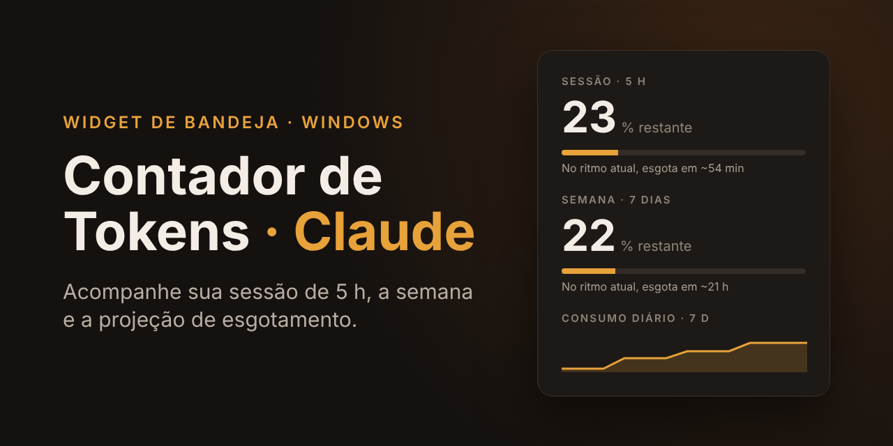

# Contador de Tokens · Claude

**Saiba quanto do seu plano Claude já foi gasto — sem abrir o app, sem abrir o site.**
Um widget de bandeja para Windows, leve e sempre à vista.

**⏳ Instalador em breve** · [Como entrar na conta](#-entrando-na-conta) · [Para desenvolvedores](#-para-desenvolvedores)

---

## 😩 O problema

Você está no meio de uma tarefa longa e, de repente, o Claude avisa que o limite acabou. Descobrir *quanto* já foi usado exige abrir o app ou o site, navegar até a tela de uso e interpretar os números.

## ✅ A solução

O **Contador de Tokens** fica na bandeja do sistema e mostra, em tempo real, o seu consumo — com projeção de quando o limite vai estourar e alerta antes disso.

## ✨ O que ele mostra

| | Recurso | Detalhe |
|---|---|---|
| ⏱️ | **Sessão de 5 horas** | Percentual usado e horário do reset |
| 📅 | **Semana de 7 dias** | Percentual usado e horário do reset |
| 🔮 | **Projeção de esgotamento** | "Esgota em ~X" com base no seu ritmo atual |
| 💰 | **Créditos de uso** | Quando a sessão zera, mostra o valor em R$ em vez de uma porcentagem negativa |
| 📊 | **Consumo diário** | Gráfico para ver em que dias você mais usa |
| 🔔 | **Alerta configurável** | Bip + aviso no widget quando restar X % |
| 🎨 | **Conforto** | Tema claro/escuro, instância única, posição lembrada e altura automática (sem barra de rolagem) |

## 🚀 Instalação

> **⏳ Instalador em breve.** O primeiro release com o `.exe` ainda não foi publicado; assim que sair, ele ficará na página de [Releases](../../releases).

Quando estiver disponível, a instalação será assim:

1. **Baixe** o instalador na página de Releases.
2. **Dê duplo-clique.** Ele instala o app, cria o atalho no Menu Iniciar, ativa o início com o Windows e instala o WebView2 se estiver faltando.
3. Se o SmartScreen avisar (o instalador não é assinado): **Mais informações → Executar assim mesmo**.

Quer testar agora? Dá para gerar o instalador a partir do código, seguindo [`installer/COMO-COMPILAR.md`](installer/COMO-COMPILAR.md).

> O `.exe` não fica no repositório; será distribuído apenas pelos Releases.

## 🔑 Entrando na conta

**Com o Claude Desktop instalado e logado**, não precisa fazer nada: o app usa o token dele automaticamente.

**Sem o Claude Desktop**, entre direto pelo widget:

1. Clique no **ícone de pessoa** → **Entrar na conta Claude**.
2. Faça login no navegador e clique em **Authorize**.
3. Copie o código (`CODE#STATE`), cole no widget e clique em **Entrar**.

Quando aparecer **"● Conectado à sua conta Claude"**, pronto. O token fica guardado **localmente**, protegido pelo DPAPI do Windows, e é **renovado sozinho**. Para sair, clique de novo no ícone de pessoa.

## 🔒 Privacidade

- O token nunca sai da sua máquina, exceto nas chamadas ao próprio serviço da Anthropic para consultar o seu uso.
- Armazenamento local protegido pelo DPAPI do Windows.
- Sem telemetria, sem servidor intermediário.
- Código aberto: leia o que ele faz em [`src/`](src).

## 🧰 Para desenvolvedores

<b>Estrutura do repositório</b>

| Pasta | Conteúdo |
|---|---|
| [`src/`](src) | Código Python (pywebview + UI em HTML): `v4/` app e interface, `v5/` login OAuth e armazenamento do token |
| [`packaging/`](packaging) | `.spec` do PyInstaller e metadados de versão |
| [`installer/`](installer) | Script Inno Setup (`app.iss`) e [instruções de compilação](installer/COMO-COMPILAR.md) |
| [`scripts/`](scripts) | Utilitários de diagnóstico |
| [`docs/`](docs) | Especificação de apps híbridos com WebView |

<b>Como funciona</b>

O app é uma janela pywebview: a interface é HTML/JS e o host em Python consulta o endpoint de uso da conta, guarda o token e entrega à UI um *snapshot* do estado. A UI é função desse snapshot, o que facilita testar o visual com dados falsos. Veja a [especificação](docs/webview-hybrid-apps-spec-driven.md) para o raciocínio completo.

Para gerar o instalador, siga [`installer/COMO-COMPILAR.md`](installer/COMO-COMPILAR.md).

## 🗑️ Desinstalar

Execute `%LOCALAPPDATA%\Contador de Tokens\desinstalar.bat`.

## 📝 Histórico de versões

- **v5.2** — versão atual.
- **v5.1** — corrige a janela que abria fora da tela (escala 125 %/150 %) e a barra de rolagem indevida. Detalhes em [`LEIA-ME-v5.1.md`](LEIA-ME-v5.1.md).
- **v5.0** — login pela conta Claude dentro do app, sem depender do Claude Desktop.

## ⚠️ Aviso

Projeto independente, sem vínculo com a Anthropic. Usa o fluxo de login e o endpoint de uso não oficiais; podem mudar sem aviso.
